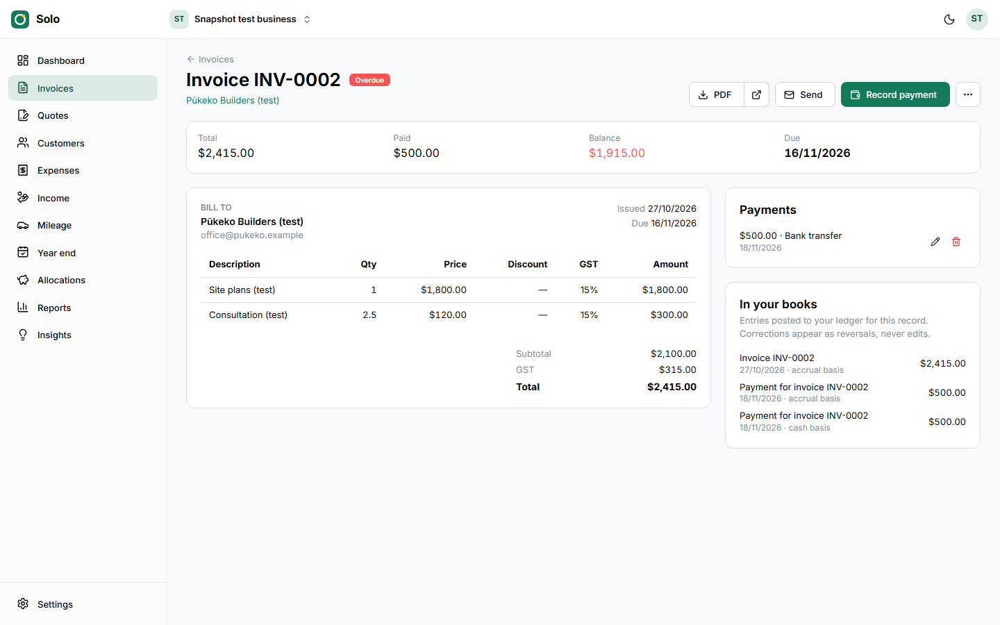
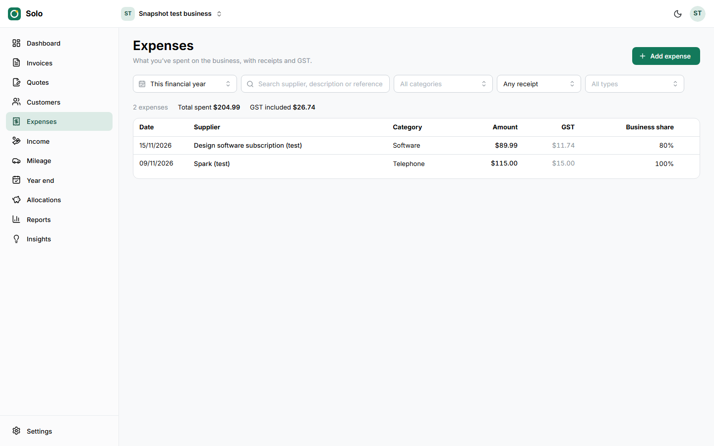
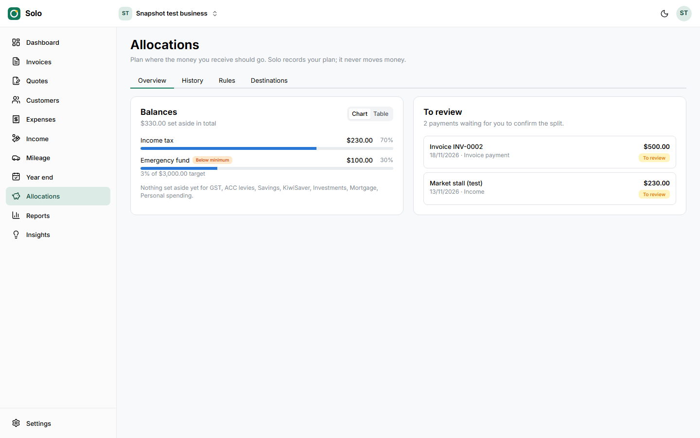
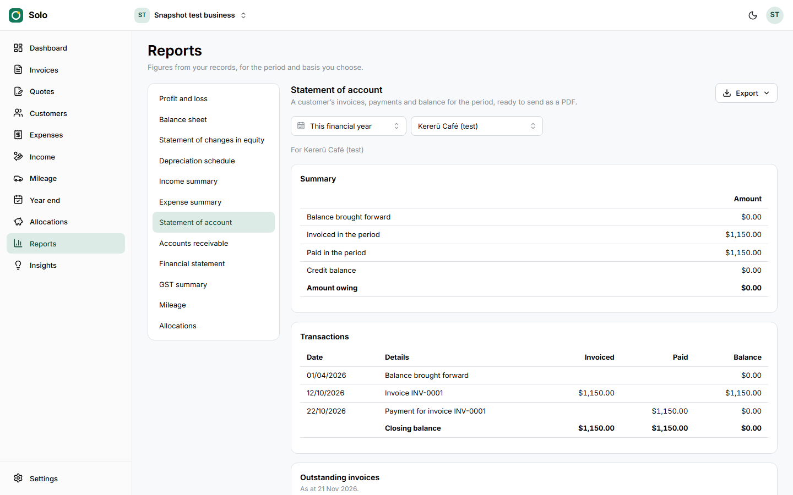
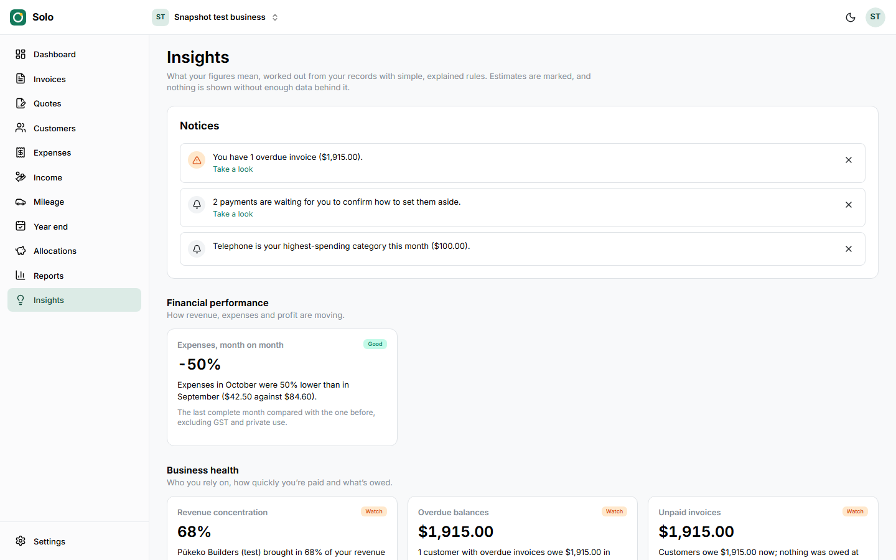
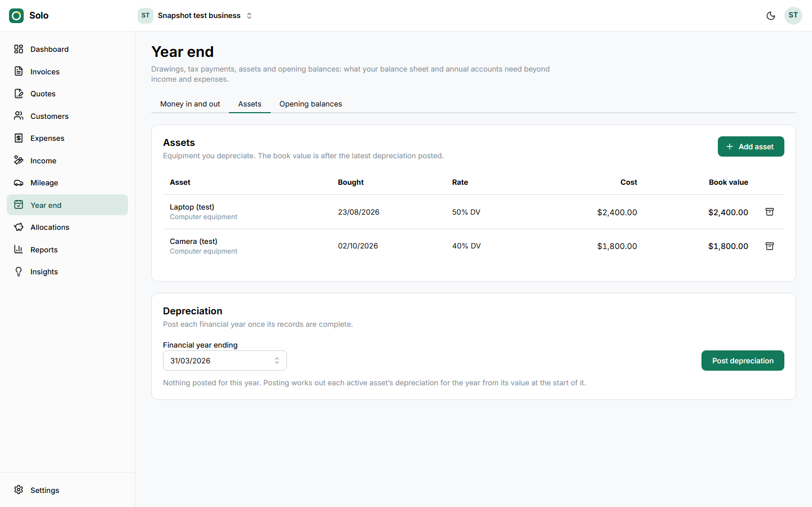
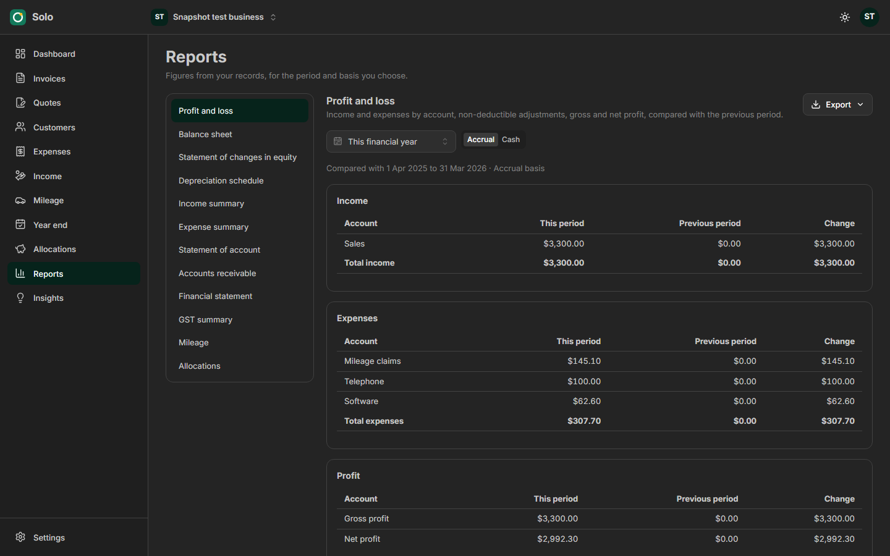
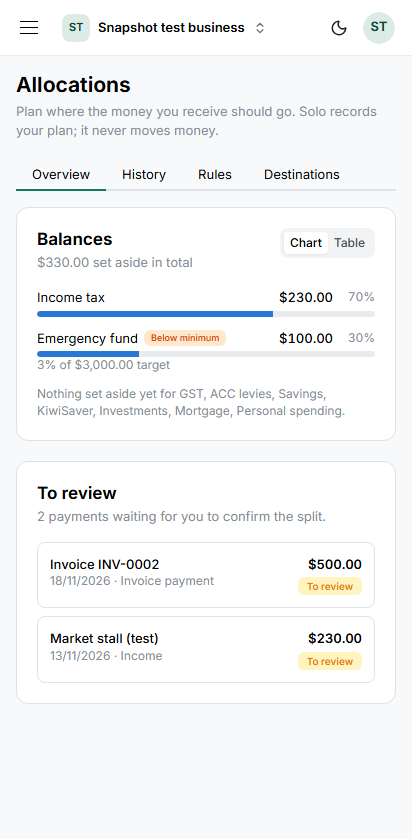

<p align="center">
  
</p>

# Solo

Simple bookkeeping for New Zealand sole traders, contractors and freelancers: invoices, expenses,
mileage, income allocations, annual accounts, reports and insights in one place. Manual entry first; no bank feeds,
OCR or tax filing in the initial releases.

Install the desktop app and start: your books stay on your computer, with nothing to set up and no
account or password. It opens straight into your books.

> The product name, colours and logos come from [`branding/brand.json`](branding/brand.json) and can be
> changed without touching code ([branding guide](docs/development/branding.md)).

## Features

<details>
<summary><strong>What Solo does today</strong> (phases 0–6 and annual accounts)</summary>

**Businesses**

- No account or sign-in: the app is yours and opens straight into your books
- Several businesses, each with its own records
- GST registration with dated rates, financial year, cash or accrual reporting basis, branding for documents
- Export everything as one file

**Invoices, quotes and customers**

- Customers with contact details, balances and a statement of account
- Quotes that become invoices; invoices with GST per line, discounts, numbering and branded PDFs
- Send by email (logged), record payments (part or full, with any tax the customer withheld), edit or
  remove them with a reason

**Expenses and income**

- Expenses by category with receipts, GST worked out, and business, private or partial use; categories
  can be marked not deductible (e.g. penalties)
- Income without an invoice (cash sales, interest, grants)
- A double-entry ledger on both bases behind every figure; corrections post reversals, never edits

**Mileage**

- Vehicles, your own kilometre rates with dated versions and IRD's two tiers (tier 2 after 14,000 km a
  year), trips by distance or odometer
- Claims calculated per trip and included in expenses; report and CSV export

**Year end**

- Money in and out: drawings, funds introduced, and GST and income tax paid to or refunded by IRD
- Fixed assets with yearly depreciation (diminishing value or straight line, at your rates, private use
  split out), posted per financial year
- Home office by IRD's square metre rate, one claim a year
- GST change-of-use reviews for assets over $10,000, with IRD's adjustment periods and thresholds
- Opening balances from your accountant's last balance sheet
- Built against a sole trader's real accountant-prepared annual reports; the tests check two years of
  annual accounts figure by figure, comparatives included (with a made-up business's data)

**Allocations** (planning only: Solo never moves money)

- Destinations such as income tax, GST, savings and KiwiSaver, with targets and minimum balances
- Rules by percentage or fixed amount, in priority order, with conditions, caps and targets
- A proposed split for every payment received, reviewed and confirmed by you; balances and history

**Reports**

- Profit and loss (with non-deductible adjustments), balance sheet, statement of changes in equity,
  depreciation schedule, income and expense summaries, statement of account, accounts receivable and
  ageing, financial statement, GST summary, mileage and allocations
- Any period and basis, filtered by customer, category or vehicle; every report as PDF, CSV or Excel, or all of them in
  one file

**GST returns**

- Each GST period (monthly, two-monthly or six-monthly) with IRD's due date, GST collected and claimable,
  what was paid and what's left, on your GST basis
- What you owe IRD now, what's overdue and any refunds due; record a GST payment against a return

**Insights** (explained rules, no AI; shown only with enough data)

- How revenue, expenses and profit are moving; who you rely on, how quickly you're paid and what's owed
- Biggest, growing and unusual spending, and regular commitments
- Cash flow: what's owed, received and set aside, plus expected payments and available funds, marked as
  estimates
- Plain-language notices ("You have 2 overdue invoices") on the dashboard, dismissible

**Everywhere**

- A desktop app for Windows, macOS and Linux that keeps your books on your computer (its own database,
  works offline), and updates itself
- Light and dark themes, layouts down to phone width, and zoom with Ctrl + and Ctrl −
- A dashboard with income, expenses, profit, receivables, GST, mileage, allocation balances and notices, and
  key dates (GST returns, provisional and terminal tax, the income tax return, year end) with the days left
- A step-by-step guide in the app for people new to bookkeeping: every feature in the order you use it,
  ending with the yearly report for your accountant, with links to each screen and your progress saved

</details>

## Screenshots

<details>
<summary><strong>Show screenshots</strong> (test data, labelled “(test)”)</summary>

| | |
|---|---|
|  |  |
| Dashboard | Dashboard, dark theme |
|  |  |
| Invoices | An invoice with its payments and ledger entries |
|  |  |
| Expenses | Mileage |
|  |  |
| Allocation balances and payments to review | Reviewing the split of a payment |
|  |  |
| Profit and loss | Statement of account |
|  |  |
| Insights with notices | Insights, dark theme |
|  |  |
| Money in and out | Assets and depreciation |
|  | |
| Balance sheet beside last year end | |
|  |   |
| Reports, dark theme | On a phone |

Regenerate them with `npm run readme:screenshots` (needs the local stack; see
[testing](docs/development/testing.md)).

</details>

## Status

| Phase | Scope | Status |
|---|---|---|
| 0 | Foundation: monorepo, Rust API, React + Tauri clients, PostgreSQL + Flyway, branding, design system, CI/CD | **Done** |
| 1 | Businesses and onboarding (accounts and sign-in removed later: one person, no sign-in) | **Done** |
| 2 | Customers, invoices, quotes, PDFs, email, payments, expenses, receipts, income, ledger, dashboard | **Done** |
| 3 | Mileage: vehicles, versioned rates, trips, claims in the ledger, report and CSV export | **Done** |
| 4 | Allocations: destinations, prioritised rules with conditions, caps and targets, reviewed splits of money received, balances and history with reversals (planning only) | **Done** |
| 5 | Reports: profit and loss, income and expense summaries, statements, receivables ageing, financial statement, GST, mileage and allocations; PDF, CSV and Excel | **Done** |
| 6 | Insights: performance, business health, spending and cash flow from explained rules; dismissible notices | **Done** |
| — | Local-first desktop app: the books on your computer (embedded PostgreSQL), no sign-in, in-app updates | **Done** |
| — | Annual accounts: tax withheld, drawings and IRD payments, fixed assets and depreciation, opening balances, balance sheet, changes in equity, depreciation schedule; checked figure by figure over two years of annual accounts | **Done** |
| 7 | Improvements and integrations | Next |
| 8 | Tax functionality (last) | Planned |

Details: [roadmap](docs/product/roadmap.md) and [backlog](docs/backlog/backlog.html).

## Quick start

**Desktop app:** install it from the release page and open it. Nothing else is needed
([installation](docs/deployment/installation.md)).

Your data stays in the app's own folder on your computer; Settings › Your data downloads a copy.

## Development

Requires Node.js 24 and Rust (stable); Docker only for the API's integration tests. Desktop builds also need the
[Tauri prerequisites](https://v2.tauri.app/start/prerequisites/).

```bash
npm install
npm run desktop:dev                     # the desktop app (starts its own database and API)
npm run local:serve                     # or: the local server on its own (prints its URL)…
VITE_DEV_API_PROXY=<its URL> npm run dev   # …and the app in a browser on http://localhost:5173
npm run db:up && npm run db:test:prepare   # PostgreSQL (Docker) for the API's integration tests
```

| Command | Does |
|---|---|
| `npm run check` | Typecheck, lint, format check and client tests |
| `npm run api:test` | API unit + integration tests (needs `npm run db:test:prepare` once) |
| `npm run api:lint` | `cargo fmt --check` and clippy |
| `npm run test:e2e` | Playwright journeys against the local server and Vite |
| `npm run api:client` | Regenerate the typed client after changing the API |
| `npm run brand:sync` | Apply `branding/brand.json` to the desktop app |

More: [development setup](docs/development/setup.md) · [testing](docs/development/testing.md) ·
[contributing](CONTRIBUTING.md).

## Stack

Rust · Axum · SQLx · PostgreSQL 18 · Flyway · utoipa (OpenAPI) · React 19 · TypeScript 6 · Vite 8 ·
Mantine 9 · TanStack Query · Tauri 2 · embedded PostgreSQL · GitHub Actions · Playwright.

## Documentation

- [Architecture overview](docs/architecture/overview.md), including what was reused from Hermes Hub
- [Database](docs/architecture/database.md) ·
  [Financial model](docs/architecture/financial-model.md) · [API conventions](docs/architecture/api.md)
- [Architecture decisions](docs/decisions/README.md)
- [Product overview](docs/product/overview.md) · [Specification](docs/product/specification.md) · [Roadmap](docs/product/roadmap.md) · [Backlog](docs/backlog/backlog.html)
- [Installation](docs/deployment/installation.md) · [CI/CD](docs/deployment/ci-cd.md) · [Release process](docs/deployment/release-process.md)

## Disclaimer

Solo helps people keep their own records. It is not an accountant, a registered tax agent or a tax
filing service, and its summaries are not tax advice.
