<p align="center">
  
</p>

<h1 align="center">Solo</h1>

<p align="center">
  <strong>Bookkeeping for New Zealand sole traders, contractors and freelancers.</strong><br>
  Invoices, expenses, GST, income tax and your annual accounts, in one desktop app that keeps your books on your own computer.
</p>

<p align="center">
  <a href="https://github.com/Mansour-J/solo/releases/latest"></a>
  <a href="https://github.com/Mansour-J/solo/actions/workflows/ci.yml"></a>
  <a href="LICENSE"></a>
  
</p>

<p align="center">
  <a href="https://github.com/Mansour-J/solo/releases/latest"><strong>Download Solo</strong></a> ·
  <a href="#features">Features</a> ·
  <a href="#screenshots">Screenshots</a> ·
  <a href="#roadmap">Roadmap</a> ·
  <a href="#questions">Questions</a>
</p>

---

Solo is built for one person running their own business in New Zealand. It covers the year from the
first invoice to the report you hand your accountant: what you've earned and spent, the GST you owe, the
income tax and ACC levies to set aside, and when IRD expects to be paid.

- **Your books stay with you.** Solo runs entirely on your computer, works offline and sends nothing
  anywhere. There's no account to create, no subscription and no sign-in.
- **Made for New Zealand.** GST periods and IRD due dates, schedular payments, provisional tax, IRD's
  mileage rates, home office, depreciation and ACC levies, with the rules dated as IRD changes them.
- **Plain language.** Every screen explains itself, a step-by-step guide walks you through the year, and
  Business health tells you what's missing before it becomes a problem.
- **Real double-entry bookkeeping underneath.** Every figure comes from a proper ledger, and corrections
  are recorded, never silently edited, so your accountant can trust the numbers.

## Features

Everything below works in the current release. Click a section to expand it.

<details>
<summary><strong>Invoices, quotes and customers</strong></summary>

<br>

- Customers with contact details, balances and a statement of account you can email
- Quotes that become invoices with one click
- Invoices with GST per line, discounts, your own numbering and branded PDF documents
- Recurring invoices on a schedule
- Send by email from your own mail account, with every email logged
- Reminders before and after the due date, with a per-customer opt-out
- Record payments in part or in full, including tax a customer withheld (schedular payments)
- Write off a bad debt, with the GST adjusted

</details>

<details>
<summary><strong>Expenses, income and mileage</strong></summary>

<br>

- Expenses by category with receipts attached, GST worked out, and business, private or partial use
- Categories that aren't deductible (such as penalties), and entertainment at 50%
- Income received without an invoice: cash sales, interest, grants
- Vehicles and trips by distance or odometer, at IRD's two-tier kilometre rates or your own dated rates
- Mileage claims calculated per trip and included in your expenses, with a report and CSV export

</details>

<details>
<summary><strong>GST</strong></summary>

<br>

- GST registration with dated rates, on the payments, invoice or hybrid basis
- Every GST period (monthly, two-monthly or six-monthly) with IRD's due date
- The figures for each return, box by box, ready to copy into myIR
- What you owe IRD now, what's overdue and any refunds due; record payments against a return
- A reminder when your sales pass the $60,000 registration threshold
- Second-hand goods and change-of-use adjustments for assets over $10,000

</details>

<details>
<summary><strong>Income tax, provisional tax and ACC</strong></summary>

<br>

- Income tax estimated for each year by IRD's bands, after tax your customers withheld
- Provisional tax by IRD's standard option, with each instalment's due date and what's been paid
- Terminal tax and refunds, with key dates (GST, provisional and terminal tax, the return, year end)
  and the days left on the dashboard
- ACC levies for the year: the earners' levy, your industry's work levy and the Working Safer levy,
  between ACC's minimum and maximum earnings, plus GST

</details>

<details>
<summary><strong>Year end and annual accounts</strong></summary>

<br>

- Money in and out: drawings, funds introduced, and GST and income tax paid to or refunded by IRD
- Fixed assets with yearly depreciation (diminishing value or straight line, private use split out), and
  low-value assets written off
- Home office by IRD's square metre rate
- Opening balances from your accountant's last balance sheet
- Profit and loss, balance sheet and statement of changes in equity, with last year alongside
- Checked figure by figure against two years of real accountant-prepared annual reports (using an
  invented business's data)

</details>

<details>
<summary><strong>Reports and insights</strong></summary>

<br>

- Profit and loss, balance sheet, changes in equity, depreciation schedule, income and expense
  summaries, statements, receivables and ageing, GST, mileage and allocations
- Any period, on the cash or accrual basis, filtered by customer, category or vehicle
- Every report as PDF, CSV or Excel, or all of them in one file
- Insights from explained rules (no AI): how revenue and profit are moving, who you rely on, how quickly
  you're paid, unusual spending and regular commitments, and cash flow estimates
- Plain-language notices on the dashboard ("You have 2 overdue invoices"), and a weekly email of them

</details>

<details>
<summary><strong>Setting money aside</strong></summary>

<br>

- Destinations such as income tax, GST, savings and KiwiSaver, with targets and minimum balances
- Rules by percentage or fixed amount, in priority order, with conditions and caps
- A suggested split of every payment you receive, for you to review and confirm
- Planning only: Solo never moves money

</details>

<details>
<summary><strong>Your data, backups and the app</strong></summary>

<br>

- Try it first with a demo business: a made-up contractor's books, a year and a half of invoices,
  expenses, GST returns, mileage and reports, kept apart from your own, never sending email, and reset
  or removed whenever you like
- Several businesses, each with its own books
- Business health: checks you're set up to issue correct tax invoices, keep the records IRD expects and
  get paid, says why each problem matters and links to the fix
- Back up every business and its receipts to one file, and restore it on this computer or a new one,
  with a reminder when your last backup is over 30 days old
- Export everything as a readable file
- A step-by-step guide for people new to bookkeeping, from the first invoice to the yearly report for
  your accountant
- Light and dark themes, layouts down to phone width, and zoom with Ctrl + and Ctrl −
- Updates itself when a new version is released

</details>

## Screenshots

<details>
<summary><strong>Show screenshots</strong> (made-up test data)</summary>

<br>

| | |
|---|---|
| 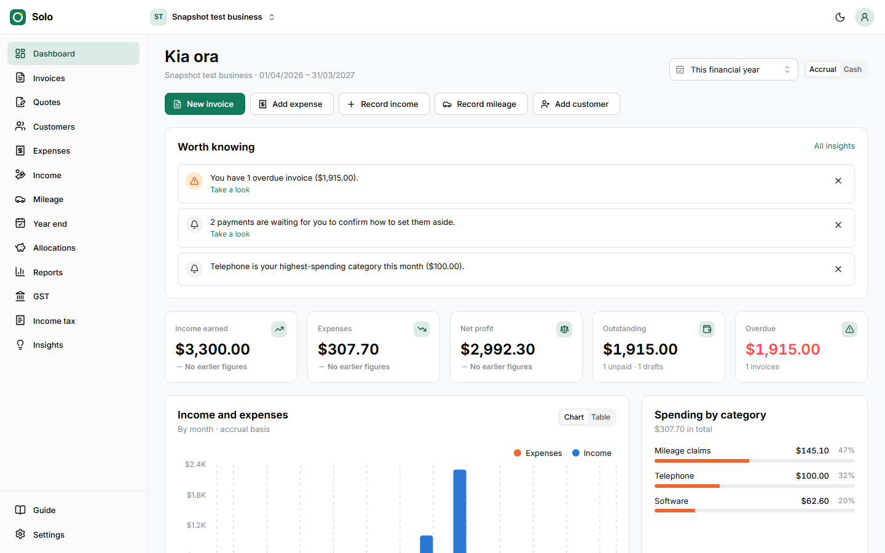 | 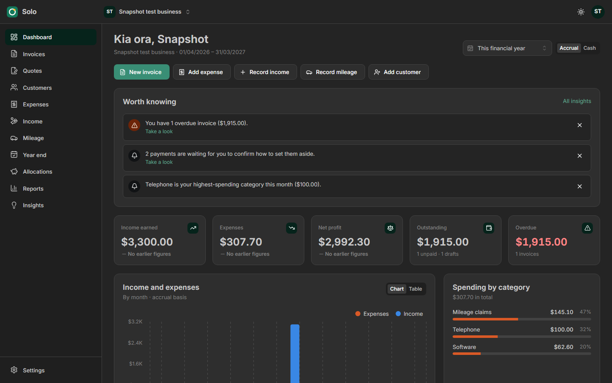 |
| Dashboard | Dashboard, dark theme |
| 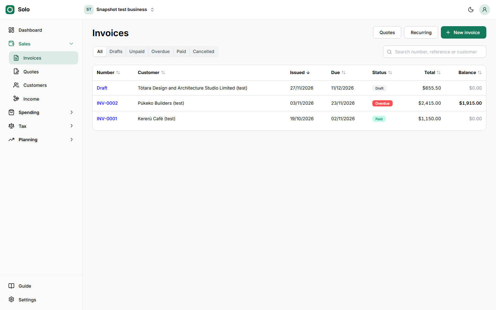 |  |
| Invoices | An invoice with its payments and ledger entries |
|  | 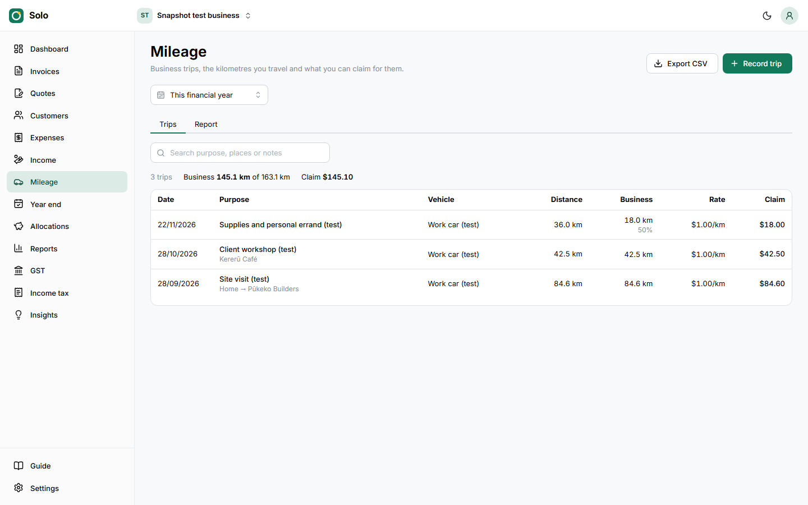 |
| Expenses | Mileage |
|  | 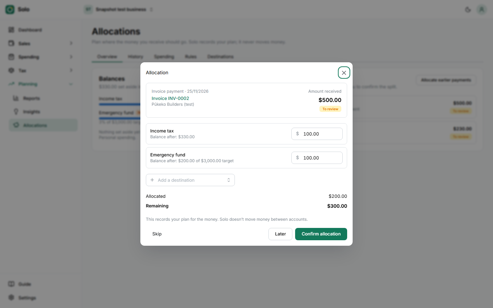 |
| Allocation balances and payments to review | Reviewing the split of a payment |
| 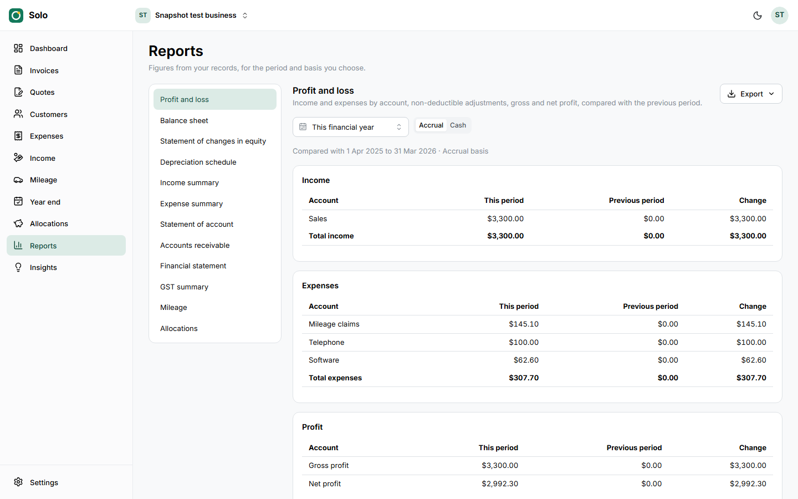 |  |
| Profit and loss | Statement of account |
|  | 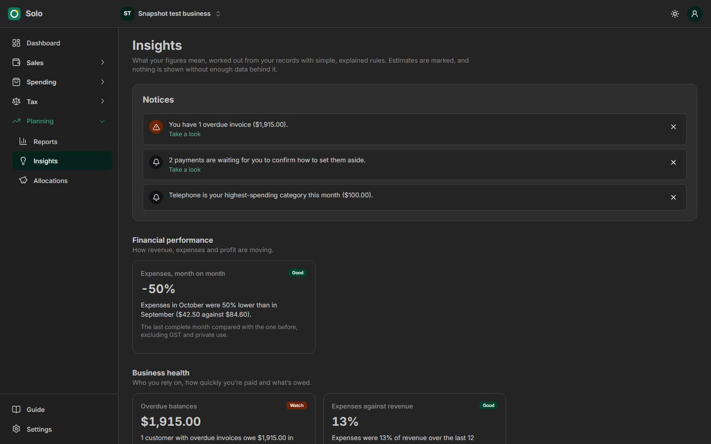 |
| Insights with notices | Insights, dark theme |
| 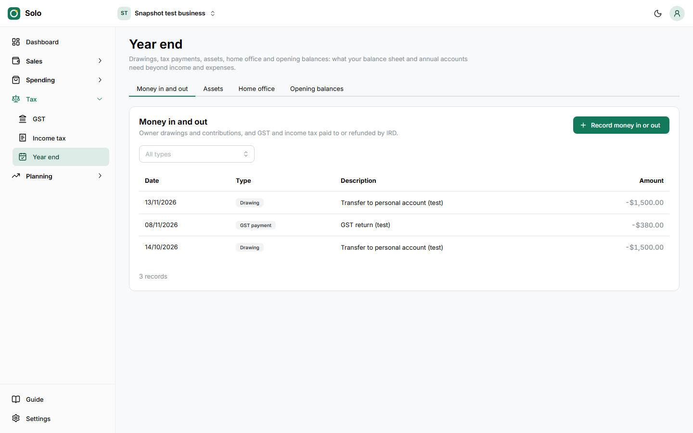 |  |
| Money in and out | Assets and depreciation |
| 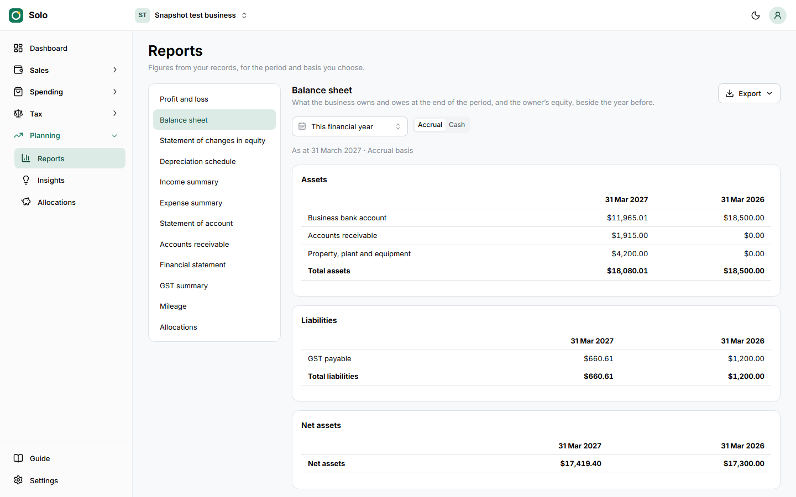 | 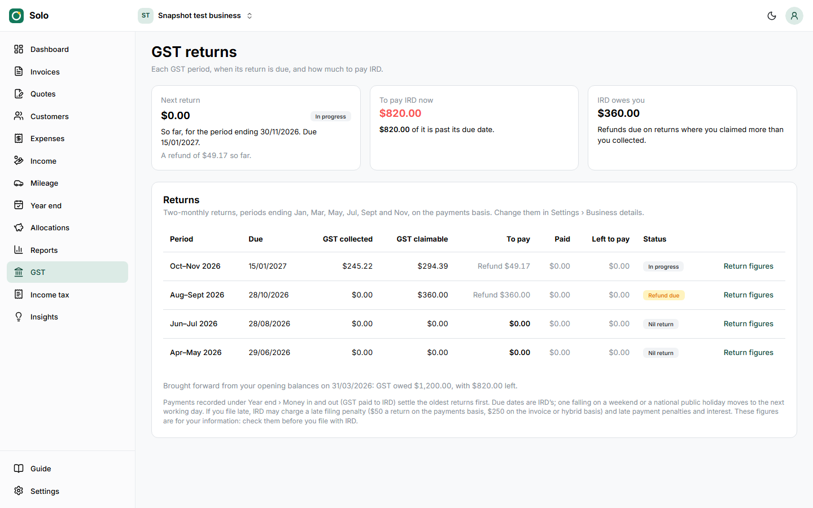 |
| Balance sheet beside last year end | GST returns with IRD’s due dates |
| 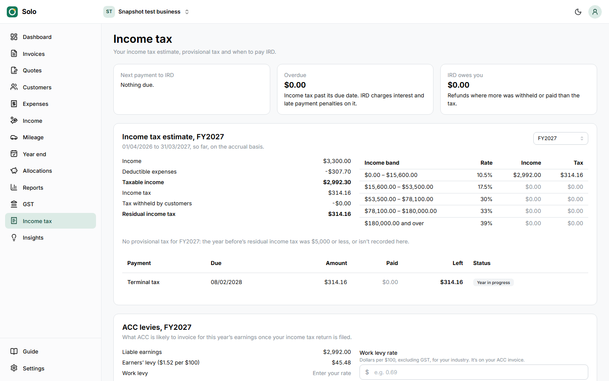 | 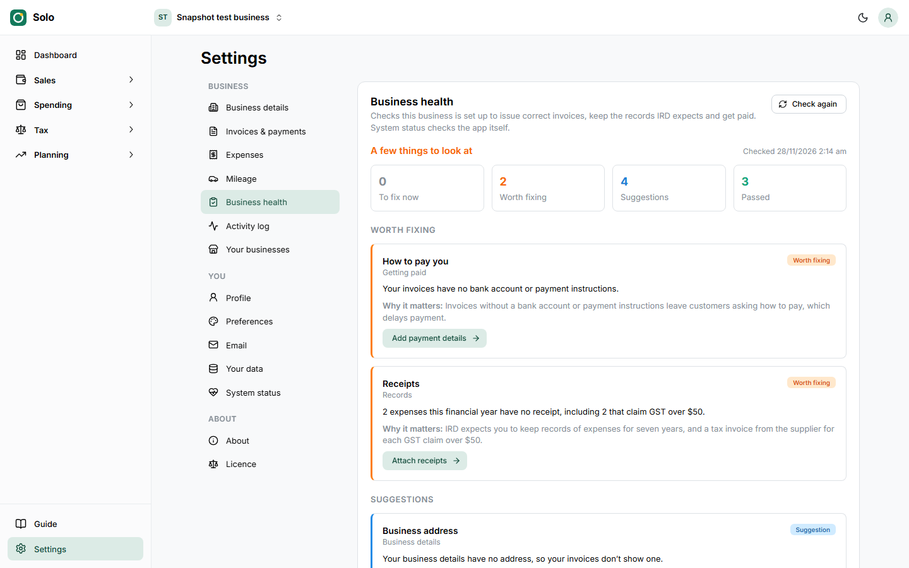 |
| Income tax, provisional tax and ACC levies | Business health |
| 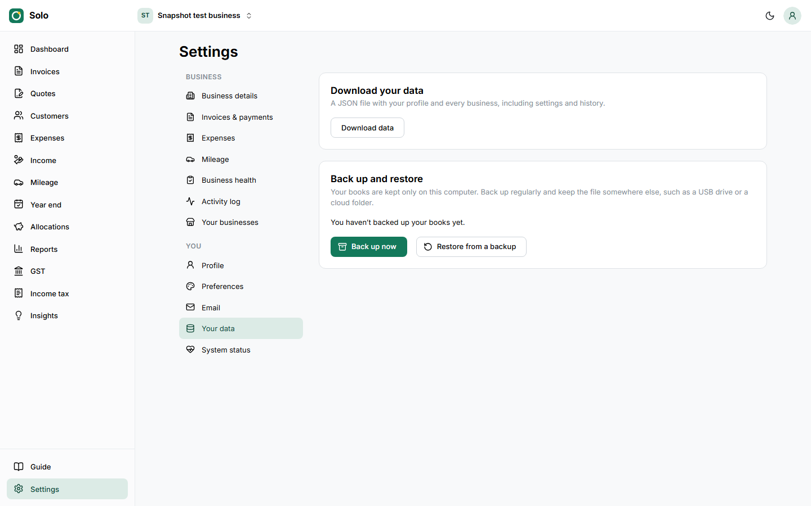 | 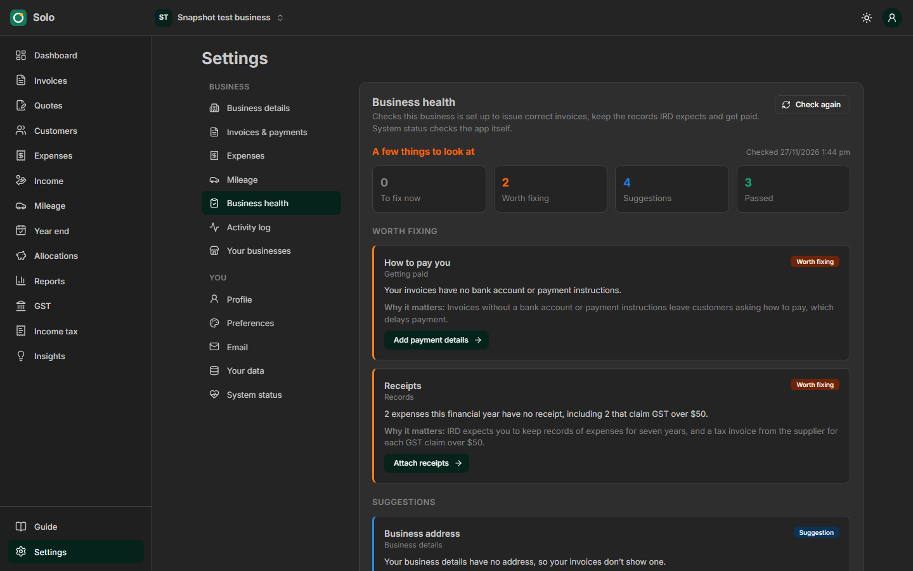 |
| Back up and restore | Business health, dark theme |
| 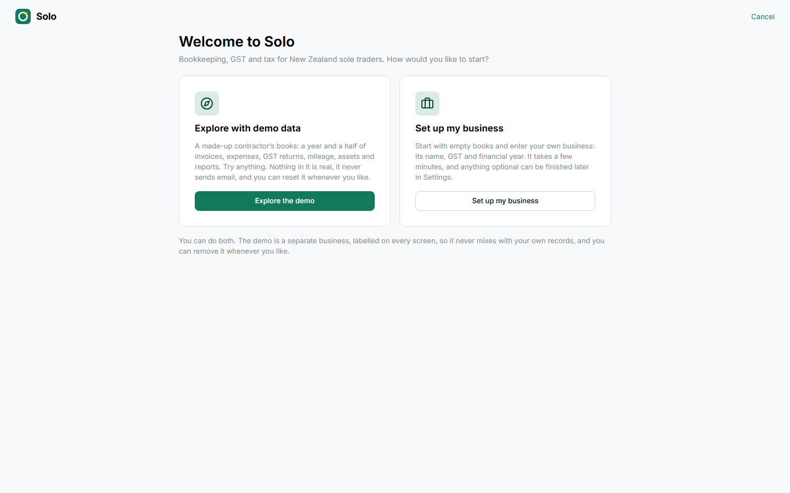 |  |
| The first screen: explore the demo or set up your business | Reports, dark theme |
| 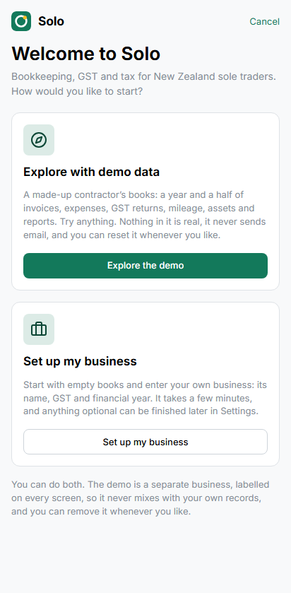 | 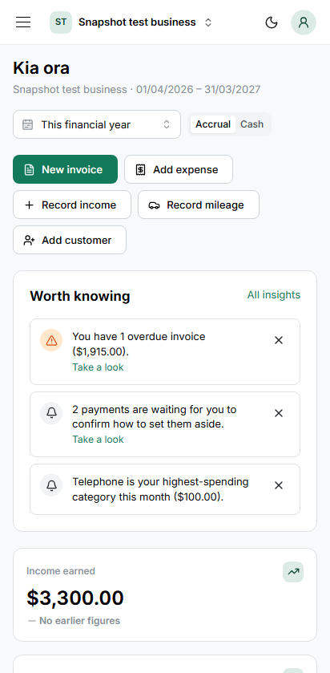 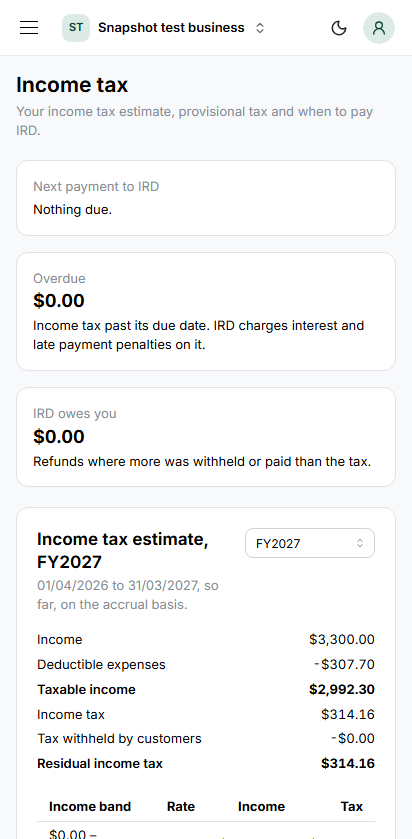 |
| The first screen on a phone | At phone width |

</details>

## Getting started

1. **Download** the installer for your computer from the
   [latest release](https://github.com/Mansour-J/solo/releases/latest).
2. **Install and open it.** There's nothing else to set up: no account, no server, no password.
3. **Explore the demo or set up your business.** The first screen offers both: a demo business of
   made-up records to try everything on, or your own business with its name, GST registration and
   financial year. Then follow the guide in the app.

<details>
<summary><strong>Which file do I download?</strong></summary>

<br>

| Computer | File |
|---|---|
| Windows | `Solo_<version>_x64-setup.exe` (or the `.msi`) |
| macOS (Apple silicon and Intel) | `Solo_<version>_universal.dmg` |
| Ubuntu, Debian | `Solo_<version>_amd64.deb` (`sudo apt install ./Solo_<version>_amd64.deb`) |
| Fedora, openSUSE | `Solo-<version>-1.x86_64.rpm` |
| Any Linux | `Solo_<version>_amd64.AppImage` (make it executable, then run it) |

The installers aren't code-signed yet, so Windows and macOS may warn that the app is from an unknown
developer the first time you open it. See the [installation guide](docs/deployment/installation.md).

</details>

<details>
<summary><strong>Updates, backups and where your data lives</strong></summary>

<br>

- **Updates:** Settings › Updates installs new versions, which are signed. Your books are kept and
  brought up to date when the new version starts.
- **Backups:** Settings › Your data › **Back up now** saves one file with every business and its
  receipts. Keep it somewhere other than your computer, such as a USB drive or a cloud folder.
  **Restore from a backup** brings it back, here or on a new computer.
- **Your data** is in the app's own folder on your computer. Anyone who can use your computer account
  can open it, so protect the account and turn on disk encryption.

</details>

## Roadmap

Solo is built in phases. Each phase ships complete, tested features; later work is tracked in the
[backlog](docs/backlog/backlog.html) and the [roadmap](docs/product/roadmap.md).

<details>
<summary><strong>Phases 0–8: 9 done, 2 in progress</strong></summary>

<br>

| Phase | What it delivers | Status |
|---|---|---|
| 0 | Foundation: the app, its database, design system and automated releases | ✅ Done |
| 1 | Businesses and setting up | ✅ Done |
| 2 | Core bookkeeping: customers, quotes, invoices, payments, expenses, receipts, income, the ledger | ✅ Done |
| 3 | Mileage | ✅ Done |
| 4 | Allocations: setting money aside | ✅ Done |
| 5 | Reports, as PDF, CSV and Excel | ✅ Done |
| 6 | Insights and notices | ✅ Done |
| — | Annual accounts: assets, depreciation, balance sheet, year-end figures | ✅ Done |
| — | The desktop app: your books on your computer, no sign-in, updates, backups | ✅ Done |
| 7 | Improvements and integrations | 🔄 In progress |
| 8 | Tax | 🔄 In progress |

</details>

<details>
<summary><strong>Phase 7: improvements and integrations</strong></summary>

<br>

- ✅ Recurring invoices
- ✅ Invoice reminders
- ✅ Advanced exports
- ✅ Business health
- ✅ A demo business to explore on first run
- ⏸️ Later: importing from other software, reading receipts automatically, bank feeds, online invoice
  payments, a mobile app

</details>

<details>
<summary><strong>Phase 8: tax</strong></summary>

<br>

- ✅ GST return figures, box by box
- ✅ Income tax and ACC levy estimates
- ✅ Provisional tax (standard option)
- ✅ Entertainment at 50%, bad debts, the GST registration reminder, second-hand goods and change of use,
  home office, low-value assets
- ⏸️ Later: preparing the income tax return (IR3), and filing with IRD from the app

</details>

## Questions

<details>
<summary><strong>Does Solo replace my accountant?</strong></summary>

<br>

No. Solo keeps your records and estimates what you owe, so your accountant gets clean books and the
report they need at year end. It isn't an accountant, a tax agent or a filing service, and its figures
aren't tax advice.

</details>

<details>
<summary><strong>Does it file my GST or income tax return?</strong></summary>

<br>

Not yet. Solo gives you the GST return's figures box by box to copy into myIR, and estimates income
tax, provisional tax and ACC levies. Filing from the app is on the roadmap (phase 8).

</details>

<details>
<summary><strong>Does it connect to my bank?</strong></summary>

<br>

No. You enter records yourself, which keeps everything on your computer. Bank feeds are on the roadmap
for later.

</details>

<details>
<summary><strong>Can I use it on my phone?</strong></summary>

<br>

Not yet. Solo is a desktop app for Windows, macOS and Linux. A mobile app is on the roadmap for later.

</details>

<details>
<summary><strong>What does it cost?</strong></summary>

<br>

Nothing. Solo is free and open-source software under the AGPL-3.0 licence.

</details>

<details>
<summary><strong>What happens if my computer breaks?</strong></summary>

<br>

If you've made a backup (Settings › Your data › **Back up now**) and kept it somewhere else, install Solo
on the new computer and choose **Restore from a backup**. Solo reminds you when your last backup is over
30 days old.

</details>

## For developers

<details>
<summary><strong>Stack, setup and commands</strong></summary>

<br>

**Stack:** Rust · Axum · SQLx · PostgreSQL 18 (embedded in the desktop app) · utoipa (OpenAPI) · React 19 ·
TypeScript · Vite · Mantine · TanStack Query · Tauri 2 · Playwright · GitHub Actions.

Requires Node.js 24 and Rust (stable); Docker only for the API's integration tests. Desktop builds also
need the [Tauri prerequisites](https://v2.tauri.app/start/prerequisites/).

```bash
npm install
npm run desktop:dev                        # the desktop app (starts its own database and API)
npm run local:serve                        # or: the local server on its own (prints its URL)…
VITE_DEV_API_PROXY=<its URL> npm run dev   # …and the app in a browser on http://localhost:5173
npm run db:up && npm run db:test:prepare   # PostgreSQL (Docker) for the API's integration tests
```

| Command | Does |
|---|---|
| `npm run check` | Typecheck, lint, format check and client tests |
| `npm run api:test` | API unit and integration tests, and the local server's tests |
| `npm run api:lint` | `cargo fmt --check` and clippy |
| `npm run test:e2e` | Playwright journeys against the local server and Vite |
| `npm run api:client` | Regenerate the typed client after changing the API |
| `npm run brand:sync` | Apply `branding/brand.json` to the desktop app |

The product name, colours and logos come from [`branding/brand.json`](branding/brand.json)
([branding guide](docs/development/branding.md)).

</details>

<details>
<summary><strong>Documentation</strong></summary>

<br>

- [Architecture overview](docs/architecture/overview.md) · [Database](docs/architecture/database.md) ·
  [Financial model](docs/architecture/financial-model.md) · [API conventions](docs/architecture/api.md)
- [Architecture decisions](docs/decisions/README.md)
- [Product overview](docs/product/overview.md) · [Specification](docs/product/specification.md) ·
  [IRD rules and how they're tested](docs/product/ird-rules.md)
- [Installation](docs/deployment/installation.md) · [CI/CD](docs/deployment/ci-cd.md) ·
  [Release process](docs/deployment/release-process.md)
- [Development setup](docs/development/setup.md) · [Testing](docs/development/testing.md) ·
  [Contributing](CONTRIBUTING.md)

</details>

## Disclaimer

Solo helps people keep their own records. It is not an accountant, a registered tax agent or a tax filing
service, and its summaries and estimates are not tax advice. Check figures with IRD or your accountant
before you rely on them.

## Licence

Solo is free software under the [GNU Affero General Public License v3.0](LICENSE) (`AGPL-3.0-only`). You
may use, study, change and share it; if you distribute it, or run a changed version as a network
service, you must make your source code available under the same licence.
